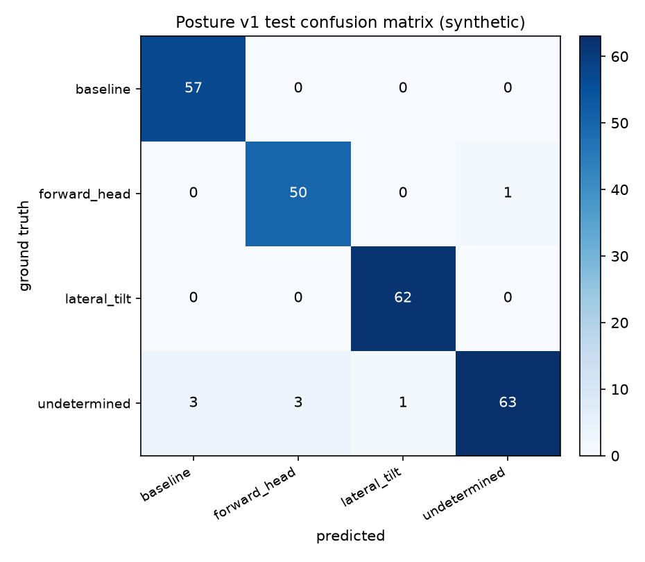

# ModelArts 姿态模型：训练包对接层

云端契约只有一份：`apps/cloud-api/app/schemas/posture.py` 与
`app/services/posture_features.py`。训练包不再保留契约副本。

## 文件

| 文件 | 作用 | 能否进 ModelArts 模型包 |
|---|---|---|
| `posture_contract.py` | 从 cloud-api 取 33 点、5 特征、类别、阈值；训练与校验用 | 否 |
| `posture_runtime.py` | 部署副本：纯 Python 特征提取与响应组装，无 torch | 是 |
| `label_policy.py` | 标注口径（预标注/合成数据）；引用 mock 阈值 | 否 |
| `dataset_check.py` | jsonl 校验：契约、特征一致性、标签、取景、禁止字段 | 否 |
| `collect_frames.py` | 原始关键点 → 训练集：重算 5 特征、分配 `frame_id`、拒绝画面字段 | 否 |
| `capture_webcam.py` | 摄像头采集：MediaPipe 33 点 → 仅关键点 jsonl，不写画面 | 否 |
| `list_cameras.py` | 列出 DirectShow 摄像头序号，对应 `--camera N` | 否 |

`posture_runtime.py` 是唯一允许的重复，因为 ModelArts 只能上传模型目录。
`apps/cloud-api/tests/test_modelarts_contract_parity.py` 用 300 组随机关键点
锁定两份实现，并校验数据集里的特征与关键点自洽。

## 用法

```bash
python scripts/modelarts/dataset_check.py data/posture/frames.jsonl
python -m pytest -q
```

`dataset_check.py` 退出码 0 才允许训练。它会拒绝：关键点数量/顺序不符、
`features` 与关键点重算结果差 >1e-3、未知类别、`image`/`base64` 等画面字段。

## 真实摄像头采集（路线 B）

采集端只用 MediaPipe 导出关键点，不保存图像或视频。需要 **CPython 3.11 64 位**：
MediaPipe 没有 32 位轮子，32 位解释器会报 `No matching distribution`。

```powershell
# 32 位会失败，先确认输出 64bit
py -3.11 -c "import platform; print(platform.architecture()[0])"

py -3.11 -m venv .venv-capture
.venv-capture\Scripts\python.exe -m pip install -i https://pypi.tuna.tsinghua.edu.cn/simple `
  -r scripts/modelarts/requirements-capture.txt
```

国内直连 PyPI 下载 mediapipe 常超时，`-i` 换成清华源即可；阿里、中科大同样有效。

`cv2` 由 mediapipe 自带的 `opencv-contrib-python` 提供，不要再单独装
`opencv-python`，否则两份 `cv2` 会互相覆盖。

先确认 `--camera` 序号对应哪台设备：

```powershell
.venv-capture\Scripts\python.exe scripts/modelarts/list_cameras.py
```

```
0   Integrated Camera
1   FlyGues 的 Turbo 6V (Windows 虚拟摄像头)
```

虚拟摄像头（OBS、FlyGues 等）打开后有数秒黑屏，等投喂源接上才出画面。
脚本默认先等最多 8 秒的非黑帧（`--prime`），不计入采集时长。

先无摄像头自测：

```powershell
.venv-capture\Scripts\python.exe scripts/modelarts/capture_webcam.py --self-test `
  --out data/posture/raw/s01__baseline__laptop-cam__office.jsonl `
  --subject s01 --device laptop-cam --scene office --label baseline
```

正式采集一段：

```powershell
.venv-capture\Scripts\python.exe scripts/modelarts/capture_webcam.py `
  --out data/posture/raw/s01__baseline__laptop-cam__office.jsonl `
  --subject s01 --device laptop-cam --scene office --label baseline `
  --duration 30 --interval 0.5
```

转换成训练集（可重复追加）：

```powershell
.venv-capture\Scripts\python.exe scripts/modelarts/collect_frames.py `
  --input data/posture/raw/s01__baseline__laptop-cam__office.jsonl `
  --out data/posture/frames_capture.jsonl --append
.venv-capture\Scripts\python.exe scripts/modelarts/dataset_check.py data/posture/frames_capture.jsonl
```

采集约束：

- 一段只放一个类别，靠文件名和 `--label` 标注，不做逐帧点击。
- `--self-test` 不需要摄像头，用来验证“采集 → collect → dataset_check”链路。
- 原始文件只有 33 点；图片、视频、base64 不会被写出。
- 训练时用 `--origin capture`；capture 帧必须 `label_source=human`，否则会被排除。
- 模型路径含中文时，脚本先复制到 `%TEMP%\riseloop-capture-models\`；
  MediaPipe 的 C++ 加载器读不了非 ASCII 路径。
- `written: 0` 且 `no_pose > 0` 表示镜头里没人或光线不足，不是脚本故障。
- MediaPipe 会给画面外关节外推坐标，坐着时腿部常到 `y≈2.8`；契约允许
  `x/y ∈ [-2,4]`、`z ∈ [-4,4]`，超出按异常帧跳过，不中断整批转换。

## 合并训练包的规则

1. 删除自带的 `contract.py` 与常量表，改为 `from posture_contract import ...`。
2. 推理包里内联的特征逻辑一律放 `posture_runtime.py`，`customize_service.py`
   只做 torch 推理；禁止在 `customize_service.py` 里再抄一份公式。
3. `customize_service.py` 必须导出 `FEATURE_SPEC_VERSION = "v2"` 与
   `features_from_keypoints`，便于测试对账。
4. 不改 `apps/cloud-api/**`、`packages/**`。发现差异改训练侧，不改服务端。
5. 合成数据必须走 `label_policy.prelabel`，并在 `metrics.json` 记录
   `policy.version`；禁止另写一套阈值。
6. 数据与权重不进 git（`artifacts/`、`data/posture/` 已忽略）。

## 指标口径

- `synthetic` 只证明管线可复现，不能对外称准确率。
- `capture` 帧按 `subject` 分组划分，同一人不得跨训练与测试。
- 报告必须同时给 macro-F1、每类 P/R/F1、混淆矩阵、样本来源与受试者数。

---

# 训练包 v1（特征契约 v2）

> **数据声明**：本轮仍是 **1440 帧合成关键点**（`origin=synthetic`、
> `label_source=prelabel`、`capture=0`、`human=0`），全部为 `framing=upper_body`。
> 以下指标只验证特征契约、训练管线和部署脚本可复现，**不代表真实场景准确率**，
> 不能对外当作模型效果。

## 契约变化：v1 → v2

| 项 | v1 | v2 |
|---|---|---|
| 派生特征 | 6 个 | 5 个 |
| 躯干前倾 | `torso_lean_deg`（依赖髋部） | 删除 |
| 整体可见比例 | `visible_ratio`（33 点） | 改为 `upper_body_visibility`（头肩 13 点） |
| 门控 | 双肩可见 + 33 点可见比例 | 双肩可见 + 头肩 13 点可见比例 |
| 采集取景 | 未记录 | `framing`，默认 `upper_body` |

依据：久坐人群面对笔记本摄像头时，画面通常只有头部和双肩。髋与腿出画时，
MediaPipe 仍会给出外推坐标，旧特征用这些坐标算前倾、旧门控按 33 点统计，
真实画面大约 15/33 点可见，会被直接判 `undetermined`。v2 只使用鼻与双肩，
不要求全身入画。

版本关系：**特征契约 `v2`，模型与报告为 `v1`**。仓库保留 `reports/v0/` 作为历史，
两代指标不可直接比较。

## 数据与标注

| 项 | 值 |
|---|---|
| 来源 | synthetic 1440 / capture 0 |
| 标签来源 | prelabel 1440 / human 0 |
| 受试者 | 12（`s01`–`s12`），每人 120 帧 |
| 机位/场景 | 4 种设备、5 种场景 |
| 取景 | upper_body 1440 / full_body 0 |
| 类别分布 | baseline 356 / forward_head 351 / lateral_tilt 327 / undetermined 406 |
| 划分 | 按 subject 70/15/15：train 960 / val 240 / test 240 |
| seed | 20261117 |
| 特征版本 | `v2` |

合成帧把髋和腿放在画面外（`y` 约 1.5–1.7），可见度压到 0.02–0.22，
与真实笔记本机位一致。`dataset_check` 对 1440 帧逐帧重算特征，
`ok: true`、`error_count: 0`、`framings: {"upper_body": 1440}`。

## 训练与结果

| 版本 | 维度 | 参数量 | 最佳 epoch | Val macro-F1 | Test macro-F1 | Test acc |
|---|---:|---:|---:|---:|---:|---:|
| **A（v1）** | 5 | 2,596 | 151 | 0.9831 | **0.9670** | 0.9667 |
| B | 137 | 11,044 | 39 | 0.8867 | 0.8432 | 0.8417 |

A 版每类 P/R/F1：

| 类别 | P | R | F1 | Support |
|---|---:|---:|---:|---:|
| baseline | 0.9500 | 1.0000 | 0.9744 | 57 |
| forward_head | 0.9434 | 0.9804 | 0.9615 | 51 |
| lateral_tilt | 0.9841 | 1.0000 | 0.9920 | 62 |
| undetermined | 0.9844 | 0.9000 | 0.9403 | 70 |

A 版混淆矩阵：

| GT \ Pred | baseline | forward_head | lateral_tilt | undetermined |
|---|---:|---:|---:|---:|
| baseline | **57** | 0 | 0 | 0 |
| forward_head | 0 | **50** | 0 | 1 |
| lateral_tilt | 0 | 0 | **62** | 0 |
| undetermined | 3 | 3 | 1 | **63** |



错误都围绕 `undetermined`：1 帧头前伸被判为不可判定；7 帧不可判定被判成具体姿态。
没有出现 `baseline` / `forward_head` / `lateral_tilt` 之间的互相误判。
A 仍明显优于 B：坐标版把画面外的髋腿也喂进模型，反而不如 5 个头肩特征稳定。

`metrics.json` 另记 `data.framing_counts` 与 `by_framing`，真实采集加入后可按机位
分别看指标，不把不同取景混在一个准确率里。

## 复跑

```bash
python -m pip install -r scripts/modelarts/requirements-train.txt
python scripts/modelarts/generate_synthetic_frames.py \
  --out data/posture/frames.jsonl --subjects 12 --frames-per-subject 120 --seed 20261117
python scripts/modelarts/dataset_check.py data/posture/frames.jsonl
python scripts/modelarts/train_posture.py --data data/posture/frames.jsonl --seed 20261117
python scripts/modelarts/evaluate_posture.py --artifacts scripts/modelarts/artifacts/v1
```

- 训练约 5–10 s（CPU 单线程）；独立评估 <1 s。
- `metrics.json` 含 `label_policy.version: "v2"`、`decision_rule`、
  `feature_spec_version: "v2"`、`data.framing_counts`、`by_framing`、`low_confidence_count`。
- 合成数据同 seed 可复现；同 seed 两次训练，A/B 的 macro-F1、accuracy、混淆矩阵一致。
- 可复核的产物提交在 `reports/v1/`（`metrics.json`、`feature_spec.json`、
  `split.json`、`smoke_test.json`、混淆矩阵）；权重与原始数据不入库。

## 测试

```bash
python -m pytest -q
```

- 本轮全绿：**150 passed**。
- 覆盖决策规则、生成器跨 `PYTHONHASHSEED` 复现、采集链路、`framing` 校验，
  以及“只有头肩可见仍能分类”的回归用例。

## 部署

ModelArts 推理包包含：

```
customize_service.py   # 校验 feature_spec 顺序 + torch 前向 + 日志
posture_runtime.py     # 上游唯一部署副本：5 特征、features_vector、build_response、决策规则
model.py               # MLP、checkpoint、B 版坐标归一化
model.pt               # A 版，14,461 B
feature_spec.json      # v2：33 点顺序、头肩 13 点、5 特征、4 类、label_policy、标准化统计
```

`customize_service.py` 导出 `FEATURE_SPEC_VERSION = "v2"` 与
`features_from_keypoints`（来自 `posture_runtime`）；特征缺失时用 runtime 重算，
`features` 齐全时优先使用请求值。关键点边界与服务端一致：
`x/y ∈ [-2,4]`、`z ∈ [-4,4]`，坐姿腿部外推到 `y≈1.6–2.8` 不会被拒。
`posture_runtime.decide_posture` 是训练评估与线上共用的唯一决策规则：
argmax，`confidence < 0.5` 时输出 `posture=undetermined`。

本机实测单帧约 0.3–0.5 ms，HTTP 端到端 <1 ms；远低于 50 ms。

## 局限

- 0 帧真实采集、0 条人工标签；指标只验证管线，不能外推为通用准确率。
- 合成数据只覆盖头肩入画的笔记本机位；站立、全身机位未建模。
- 单人、单帧、无时序平滑；遮挡是 visibility 数值模拟。
- test 仅 2 名受试者 240 帧，方差大；灰区本身存在标注分歧。
- 不包含风险融合、状态迁移、就医判断；这些留在服务端。
- ModelArts 真实端点未上传（本机无云凭证）。
