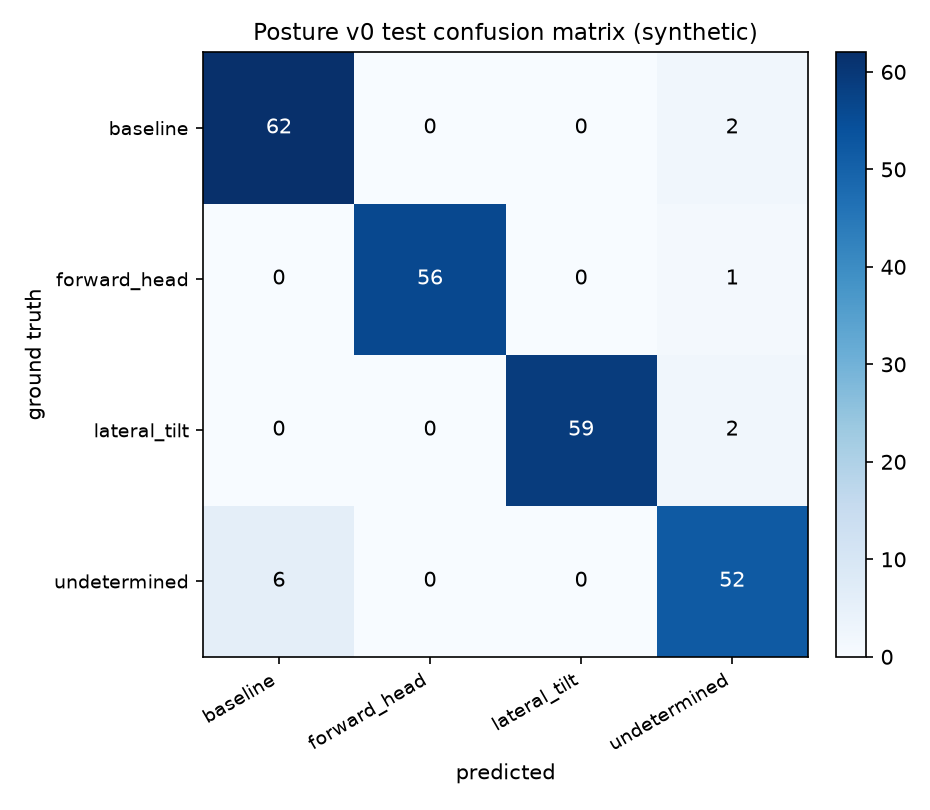

# ModelArts 姿态模型：训练包对接层

云端契约只有一份：`apps/cloud-api/app/schemas/posture.py` 与
`app/services/posture_features.py`。训练包不再保留契约副本。

## 文件

| 文件 | 作用 | 能否进 ModelArts 模型包 |
|---|---|---|
| `posture_contract.py` | 从 cloud-api 取 33 点、6 特征、类别、阈值；训练与校验用 | 否 |
| `posture_runtime.py` | 部署副本：纯 Python 特征提取与响应组装，无 torch | 是 |
| `label_policy.py` | 标注口径（预标注/合成数据）；引用 mock 阈值 | 否 |
| `dataset_check.py` | jsonl 校验：契约、特征一致性、标签、禁止字段 | 否 |

`posture_runtime.py` 是唯一允许的重复，因为 ModelArts 只能上传模型目录。
`apps/cloud-api/tests/test_modelarts_contract_parity.py` 用 300 组随机关键点
锁定两份实现，并校验数据集里的特征与关键点自洽。

## 用法

```bash
python scripts/modelarts/dataset_check.py data/posture/frames.jsonl
python -m pytest -q
```

`dataset_check.py` 退出码 0 才允许训练。它会拒绝：关键点数量/顺序不符、
`features` 与关键点重算结果差 >1e-3、未知类别、`image`/`base64` 等画面字段。

## 合并训练包的规则

1. 删除自带的 `contract.py` 与常量表，改为 `from posture_contract import ...`。
2. 推理包里内联的特征逻辑一律放 `posture_runtime.py`，`customize_service.py`
   只做 torch 推理；禁止在 `customize_service.py` 里再抄一份公式。
3. `customize_service.py` 必须导出 `FEATURE_SPEC_VERSION = "v1"` 与
   `features_from_keypoints`，便于测试对账。
4. 不改 `apps/cloud-api/**`、`packages/**`。发现差异改训练侧，不改服务端。
5. 合成数据必须走 `label_policy.prelabel`，并在 `metrics.json` 记录
   `policy.version`；禁止另写一套阈值。
6. 数据与权重不进 git（`artifacts/`、`data/posture/` 已忽略）。

## 指标口径

- `synthetic` 只证明管线可复现，不能对外称准确率。
- `capture` 帧按 `subject` 分组划分，同一人不得跨训练与测试。
- 报告必须同时给 macro-F1、每类 P/R/F1、混淆矩阵、样本来源与受试者数。

---

# 训练包 v0（上游契约对齐后）

> **数据声明**：本轮仍是 **1440 帧合成关键点**（`origin=synthetic`、
> `label_source=prelabel`、`capture=0`、`human=0`）。以下指标只验证特征契约、
> 训练管线和部署脚本可复现，**不代表真实场景准确率**，不能对外当作模型效果。

## 数据与标注

| 项 | 值 |
|---|---|
| 来源 | synthetic 1440 / capture 0 |
| 标签来源 | prelabel 1440 / human 0 |
| 受试者 | 12（`s01`–`s12`），每人 120 帧 |
| 机位/场景 | 4 种设备、5 种场景 |
| 类别分布 | baseline 331 / forward_head 339 / lateral_tilt 342 / undetermined 428 |
| 划分 | 按 subject 70/15/15：train 960 / val 240 / test 240 |
| seed | 20261117 |
| 特征版本 | `v1` |

上游 `label_policy.prelabel` 的灰区是“肩倾 6–10° **或** 头前伸 0.20–0.30”，
且强阈值是 10° / 0.30；因此 `undetermined` 从旧包的 267 增加到 428。这是口径变化，
不是数据量变化；`dataset_check` 对 1440 帧逐帧重算特征，`ok: true`、`error_count: 0`。

## 训练与结果

| 版本 | 维度 | 参数量 | 最佳 epoch | Val macro-F1 | Test macro-F1 | Test acc |
|---|---:|---:|---:|---:|---:|---:|
| **A（v0）** | 6 | 2,660 | 92 | 0.9598 | **0.9546** | 0.9542 |
| B | 138 | 11,108 | 29 | 0.8830 | 0.8878 | 0.8875 |

A 版每类 P/R/F1：

| 类别 | P | R | F1 | Support |
|---|---:|---:|---:|---:|
| baseline | 0.9118 | 0.9688 | 0.9394 | 64 |
| forward_head | 1.0000 | 0.9825 | 0.9912 | 57 |
| lateral_tilt | 1.0000 | 0.9672 | 0.9833 | 61 |
| undetermined | 0.9123 | 0.8966 | 0.9043 | 58 |

A 版混淆矩阵：

| GT \ Pred | baseline | forward_head | lateral_tilt | undetermined |
|---|---:|---:|---:|---:|
| baseline | **62** | 0 | 0 | 2 |
| forward_head | 0 | **56** | 0 | 1 |
| lateral_tilt | 0 | 0 | **59** | 2 |
| undetermined | 6 | 0 | 0 | **52** |



主要错误：`undetermined → baseline` 6 帧、`baseline → undetermined` 2 帧、
`lateral_tilt → undetermined` 2 帧、`forward_head → undetermined` 1 帧。集中在新口径的
灰区边界（肩倾 6–10° 或头前伸 0.20–0.30）；模型对边界的近似仍不是 if-else。

## 三代结果对照（同 seed 20261117）

| 版本 | A test macro-F1 | B test macro-F1 | 类别分布 |
|---|---:|---:|---|
| 初版（自带 `contract.py`） | 0.9693 | 0.9406 | 416 / 362 / 395 / 267 |
| 上一轮重建层 | 0.9746 | 0.9373 | 416 / 362 / 395 / 267 |
| **本轮上游契约** | **0.9546** | **0.8878** | **331 / 339 / 342 / 428** |

本轮指标变化同时来自两处，不能全部归因于模型：上游 `label_policy` 把
“肩倾灰区或头前伸灰区”都判 `undetermined`，`undetermined` 增加 161 帧；评估与线上
改用同一条决策规则，A 的 test 有 1 帧因 `confidence < 0.5` 改判 `undetermined`
（B 为 6 帧），val 选 epoch 也应用同一规则。没有为了保住 0.9693 绕开口径。
A 仍优于 B，按验证集 macro-F1 选择 A。

## 复跑

```bash
python -m pip install -r scripts/modelarts/requirements-train.txt
python scripts/modelarts/generate_synthetic_frames.py \
  --out data/posture/frames.jsonl --subjects 12 --frames-per-subject 120 --seed 20261117
python scripts/modelarts/dataset_check.py data/posture/frames.jsonl
python scripts/modelarts/train_posture.py --data data/posture/frames.jsonl --seed 20261117
python scripts/modelarts/evaluate_posture.py --artifacts scripts/modelarts/artifacts/v0
```

- 训练约 5.1 s（A 3.27 s + B 1.80 s，CPU 单线程）；独立评估 <1 s。
- `metrics.json` 含 `label_policy`、`decision_rule`、`feature_spec_version: "v1"`、
  `data.origin`、`metrics_scope`、`low_confidence_count`。
- 合成数据同 seed 可复现（sha256 `7514c2c8…`）；同 seed 两次训练，A/B 的
  macro-F1、accuracy、混淆矩阵一致。
- 可复核的产物提交在 `reports/v0/`（`metrics.json`、`feature_spec.json`、
  `split.json`、`smoke_test.json`、混淆矩阵）；`smoke_test.json` 只含派生特征，
  不含原始关键点，回放 endpoint 需按 seed 重新生成同 `frame_id` 的关键点；
  权重与原始数据不入库。

## 测试

```bash
# 需要 Node 在 PATH，否则 cross-language 2 个用例会 skip
python -m pytest -q
```

- 本分支：**131 passed，0 skipped**（Node 在 PATH）；上游基线 129，新增 2 个用例
  （决策规则、生成器跨 `PYTHONHASHSEED` 复现）。
- 其余使用上游 `apps/cloud-api/tests/test_modelarts_contract_parity.py`
  的 11 个用例（含 300 组随机关键点 parity、dataset_check、label_policy）。
- `dataset_check` 输出：`ok: true`，`frames: 1440`，`subjects: 12`，`errors: 0`。

## 部署

ModelArts 推理包包含：

```
customize_service.py   # 校验 feature_spec 顺序 + torch 前向 + 日志
posture_runtime.py     # 上游唯一部署副本：6 特征、features_vector、build_response、决策规则
model.py               # MLP、checkpoint、B 版坐标归一化
model.pt               # A 版，14,717 B
feature_spec.json      # v1：33 点顺序、6 特征、4 类、label_policy、标准化统计
```

`customize_service.py` 导出 `FEATURE_SPEC_VERSION = "v1"` 与
`features_from_keypoints`（来自 `posture_runtime`）；特征缺失时用 runtime 重算，
`features` 齐全时优先使用请求值。`posture_runtime.decide_posture` 是训练评估与
线上共用的唯一决策规则：argmax，`confidence < 0.5` 时输出 `posture=undetermined`。

本机实测单帧约 0.3 ms，HTTP 端到端 <1 ms；远低于 50 ms。

## 局限

- 0 帧真实采集、0 条人工标签；指标只验证管线，不能外推为通用准确率。
- 单人、单帧、无时序平滑；遮挡是 visibility 数值模拟。
- test 仅 2 名受试者 240 帧，方差大；灰区本身存在标注分歧。
- 不包含风险融合、状态迁移、就医判断；这些留在服务端。
- ModelArts 真实端点未上传（本机无云凭证）。
